# Russian Roller Coaster VR

<p align="center">
  
</p>

<p align="center">
  <strong>VR-аттракцион «Русские горки»</strong>
</p>

<p align="center">
  Интерактивный парк развлечений в виртуальной реальности с покупкой билета, посадкой в вагонетку и поездкой по протяжённому маршруту американских горок.
</p>

<p align="center">
  
  
  

</p>

---

## Содержание

- [Russian Roller Coaster VR](#russian-roller-coaster-vr)
  - [Содержание](#содержание)
  - [Описание проекта](#описание-проекта)
  - [Цель и задачи](#цель-и-задачи)
  - [Функциональные возможности](#функциональные-возможности)
    - [1. Ландшафт и инфраструктура парка](#1-ландшафт-и-инфраструктура-парка)
    - [2. Рельсовый маршрут](#2-рельсовый-маршрут)
    - [3. Вагонетка и VR-камера](#3-вагонетка-и-vr-камера)
    - [4. Билетная касса и посадка](#4-билетная-касса-и-посадка)
    - [5. Анимированные аттракционы](#5-анимированные-аттракционы)
    - [6. Атмосфера и визуальные эффекты](#6-атмосфера-и-визуальные-эффекты)
  - [Технический стек](#технический-стек)
  - [Структура проекта](#структура-проекта)
  - [Сценарий взаимодействия](#сценарий-взаимодействия)
  - [Управление](#управление)
  - [Установка и запуск](#установка-и-запуск)
    - [Необходимые инструменты](#необходимые-инструменты)
    - [Запуск из исходного кода](#запуск-из-исходного-кода)
  - [Демонстрация](#демонстрация)
  - [Источники и материалы](#источники-и-материалы)

## Описание проекта

**Russian Roller Coaster VR** — приложение виртуальной реальности, разработанное в рамках лабораторных работ по дисциплине «Разработка VR-сред».

Проект представляет собой виртуальный парк развлечений с аттракционом «Американские горки». Пользователь может свободно перемещаться по территории парка, взаимодействовать с объектами, приобретать билет и совершать поездку на вагонетке по протяжённой трассе.

Виртуальная среда включает разнообразный ландшафт, рельсовый маршрут, модели аттракционов, элементы парковой инфраструктуры и анимированные декорации. Для создания иммерсивного опыта реализованы переключение между VR-камерами, автоматическое движение вагонетки, звуковое сопровождение и эффекты, сопровождающие поездку.

Проект разработан на Godot Engine с использованием GDScript и технологий виртуальной реальности OpenXR.

## Цель и задачи

Основная цель проекта — разработка интерактивного VR-аттракциона, воспроизводящего полный цикл посещения американских горок: от исследования парка и покупки билета до завершения поездки.

В рамках разработки решаются следующие задачи:

- Создание трёхмерного ландшафта с равнинными, холмистыми и гористыми участками.
- Проектирование протяжённой трассы с рельсами, шпалами и опорными конструкциями.
- Разработка вагонетки с сиденьем и вращающимися колёсами.
- Реализация взаимодействия с билетной кассой, кошельком и входными воротами.
- Организация переключения между основным VR-персонажем и камерой внутри вагонетки.
- Автоматизация движения вагонетки по заданному маршруту.
- Создание анимированных парковых аттракционов и декораций.
- Реализация звуковых эффектов и визуальных элементов, усиливающих эффект присутствия.
- Разработка сценария завершения поездки с возвратом пользователя в парк.

## Функциональные возможности

### 1. Ландшафт и инфраструктура парка

- Трёхмерная территория с различными типами рельефа.
- Использование плагина HTerrain для формирования ландшафта.
- Ограждение территории парка, препятствующее выходу за пределы игровой зоны.
- Размещение деревьев, зданий и других объектов окружения.
- Создание пространства для свободного перемещения пользователя до начала аттракциона.

### 2. Рельсовый маршрут

- Протяжённая трасса американских горок длиной более 1000 метров согласно описанию проекта.
- Построение маршрута с использованием `Path3D` и `PathFollow3D`.
- Два металлических рельса с деревянными поперечными перекладинами.
- Металлические трубчатые опоры для поддержки рельсов.
- Автоматическое перемещение вагонетки вдоль заданной траектории.
- Обработка поворотов и изменение ориентации вагонетки для повышения реалистичности поездки.

### 3. Вагонетка и VR-камера

- Самостоятельно созданная модель вагонетки.
- Сиденье для размещения пользователя.
- Вращающиеся колёса с анимацией во время движения.
- Дополнительный узел `XROrigin3D` с VR-камерой внутри вагонетки.
- Переключение между основным игроком парка и игроком аттракциона.
- Обратный отсчёт перед началом движения.
- Автоматическая остановка после прохождения маршрута.
- Возврат управления основному игроку после завершения поездки.
- Интерполяция вращения камеры на поворотах для имитации наклона.

### 4. Билетная касса и посадка

- Билетная касса с лотком для оплаты.
- Подсветка лотка при приближении пользователя или наведении взгляда.
- Механика захвата и перемещения кошелька.
- Обнаружение взаимодействия с лотком.
- Звуковое сопровождение оплаты.
- Анимация открытия входных ворот после выполнения условия оплаты.

### 5. Анимированные аттракционы

В парке предусмотрены дополнительные движущиеся объекты, создающие атмосферу работающего парка развлечений:

- **Мельница** — вращение лопастей.
- **«Орбита»** — анимация движения элементов аттракциона.
- **«Лодка»** — анимация движения аттракциона.


### 6. Атмосфера и визуальные эффекты

- Пространственное звуковое сопровождение парка.
- Звуки движения вагонетки и встречного ветра.
- Звуковой эффект при оплате билета.
- Смена дневного и ночного освещения.
- Автоматическое включение гирлянд и освещения парковых объектов ночью.
- Система частиц `GPUParticles3D` для визуализации встречного потока воздуха.

## Технический стек

| Технология | Назначение |
|---|---|
| Godot Engine 4 | Игровой движок и создание трёхмерной среды |
| GDScript | Реализация игровой логики, взаимодействий и анимаций |
| Godot XR Tools | Инструменты для организации VR-взаимодействий |
| HTerrain | Формирование и редактирование ландшафта |

## Структура проекта

```text
RussianRollerCoaterVR/
├── Audio/                  # Звуковые ресурсы
├── Demonstration/          # Скриншоты и материалы демонстрации
├── Materials/              # Материалы и визуальные настройки
├── Models/                 # Трёхмерные модели объектов
├── Scenes/                 # Сцены Godot
├── Scripts/                # Скрипты на GDScript
├── Terrain/                # Ресурсы и элементы ландшафта
├── Textures/               # Текстуры и изображения
├── addons/                 # Дополнительные плагины
├── icon.svg                # Иконка проекта
├── openxr_action_map.tres  # Карта действий OpenXR
├── export_presets.cfg      # Настройки экспорта
└── project.godot           # Основной файл проекта
```

Назначение основных каталогов:

- **`Audio/`** — звуковые эффекты и аудиоматериалы, используемые в парке и во время поездки.
- **`Demonstration/`** — скриншоты и изображения для демонстрации внешнего вида приложения.
- **`Materials/`** — материалы поверхностей и настройки визуального оформления.
- **`Models/`** — модели вагонетки, элементов аттракционов, зданий и объектов окружения.
- **`Scenes/`** — сцены виртуального парка, аттракционов и интерактивных объектов.
- **`Scripts/`** — обработка пользовательского ввода, логика оплаты, переключение игроков, движение вагонетки и управление анимациями.
- **`Terrain/`** — ресурсы, связанные с созданием и оформлением ландшафта.
- **`Textures/`** — текстуры, применяемые к моделям и поверхностям.
- **`addons/`** — дополнительные расширения и инструменты разработки.
- **`project.godot`** — конфигурация проекта, используемая редактором Godot.

## Сценарий взаимодействия

Работа приложения организована в виде последовательного сценария.

1. **Вход в парк.** Пользователь появляется на территории виртуального парка и получает возможность свободно перемещаться по нему.
2. **Подход к кассе.** При приближении к билетной кассе лоток для оплаты визуально выделяется.
3. **Оплата.** Пользователь захватывает кошелёк и помещает его в лоток.
4. **Открытие ворот.** После обработки оплаты запускается анимация открытия прохода.
5. **Посадка.** Пользователь проходит через ворота и приближается к вагонетке.
6. **Переключение VR-камеры.** Активируется VR-персонаж внутри вагонетки, а управление основным персонажем временно отключается.
7. **Поездка.** После обратного отсчёта вагонетка начинает автоматическое движение по рельсовой трассе.
8. **Завершение.** По окончании маршрута вагонетка останавливается, а управление возвращается основному персонажу, размещённому за пределами аттракциона.

## Управление

Управление осуществляется с помощью контроллеров совместимой VR-гарнитуры.

| Действие | Способ взаимодействия |
|---|---|
| Перемещение по парку | Контроллеры VR в соответствии с настроенной схемой ввода |
| Взаимодействие с объектами | Кнопка активации или предусмотренный механизм взаимодействия |
| Захват кошелька | Механика Grab |
| Оплата билета | Перемещение кошелька в лоток кассы |
| Посадка на аттракцион | Приближение к вагонетке |
| Поездка | Автоматическое движение после обратного отсчёта |

Фактическая схема управления зависит от конфигурации VR-гарнитуры и назначений действий в проекте.

## Установка и запуск

### Необходимые инструменты

- [Godot Engine 4.x](https://godotengine.org/download/).
- Настроенное окружение OpenXR.
- Совместимая VR-гарнитура для полноценного тестирования.
- Плагины и дополнительные ресурсы, необходимые проекту.

### Запуск из исходного кода

1. Клонируйте репозиторий:

   ```bash
   git clone https://github.com/Dimasyaaa/RussianRollerCoaterVR.git
   ```

2. Перейдите в каталог проекта:

   ```bash
   cd RussianRollerCoaterVR
   ```

3. Откройте файл `project.godot` в Godot Engine 4.x.

4. Дождитесь импорта ресурсов и обработки сцен.

5. Проверьте настройки OpenXR, подключите совместимую VR-гарнитуру и настройте необходимые действия контроллеров.

6. Запустите проект из редактора Godot и проверьте работу основных сценариев.

Если необходимые плагины отсутствуют, установите совместимые версии через Asset Library или официальные репозитории соответствующих расширений.

## Демонстрация

Ниже представлены скриншоты виртуального парка и основных элементов аттракциона.

<p align="center">
  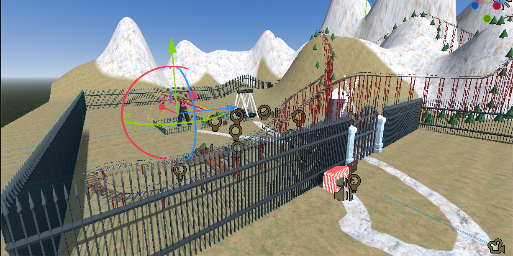
  <br>
  <em>Общий вид виртуального парка</em>
</p>

<p align="center">
  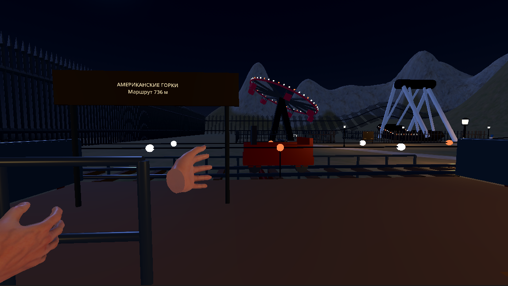
  <br>
  <em>Американские горки 1</em>
</p>

<p align="center">
  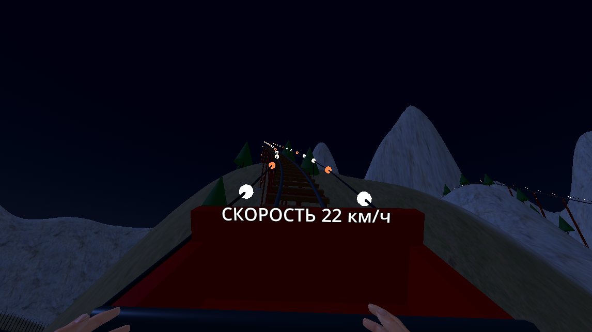
  <br>
  <em>Американские горки 2</em>
</p>

<p align="center">
  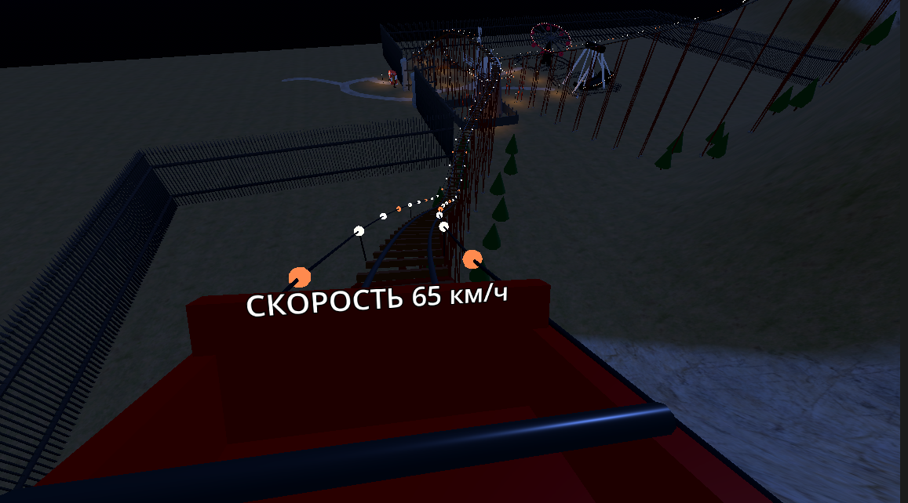
  <br>
  <em>Американские горки 3</em>
</p>

<p align="center">
  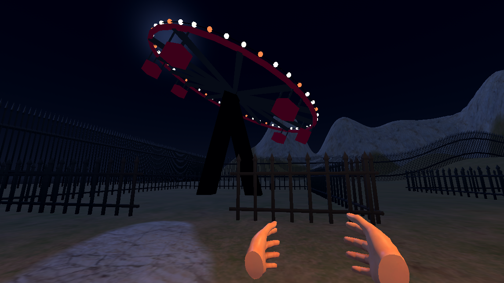
  <br>
  <em>Дополнительный аттракцион Орбита </em>
</p>
<p align="center">
  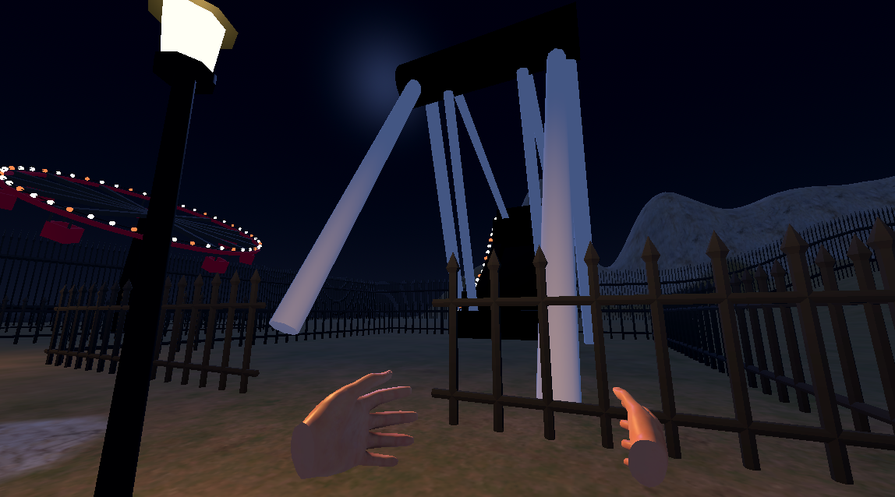
  <br>
  <em>Дополнительный аттракцион Лодка </em>
</p>
<p align="center">
  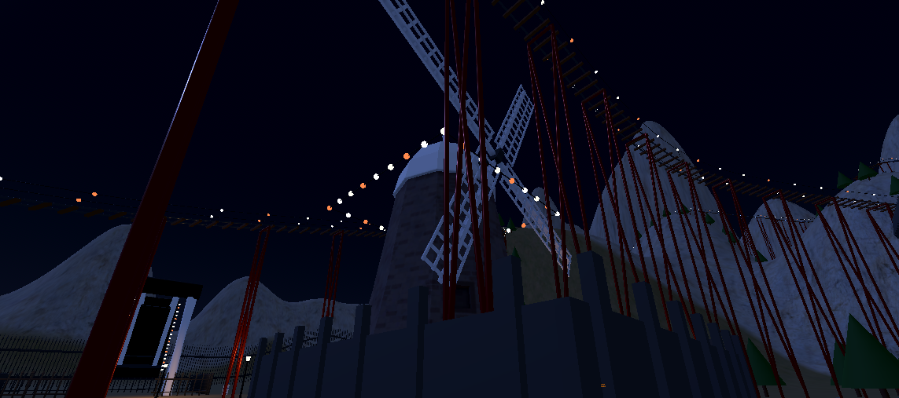
  <br>
  <em>Дополнительный объект Мельница</em>
</p>

<p align="center">
  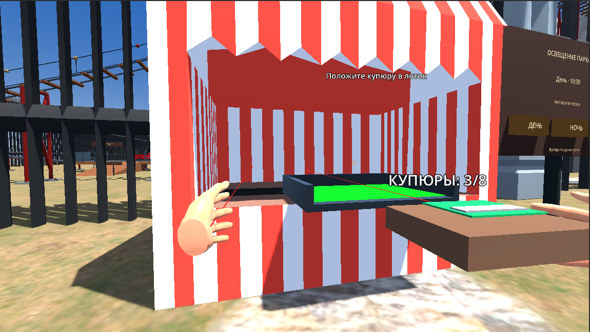
  <br>
  <em>Киоск</em>
</p>

<p align="center">
  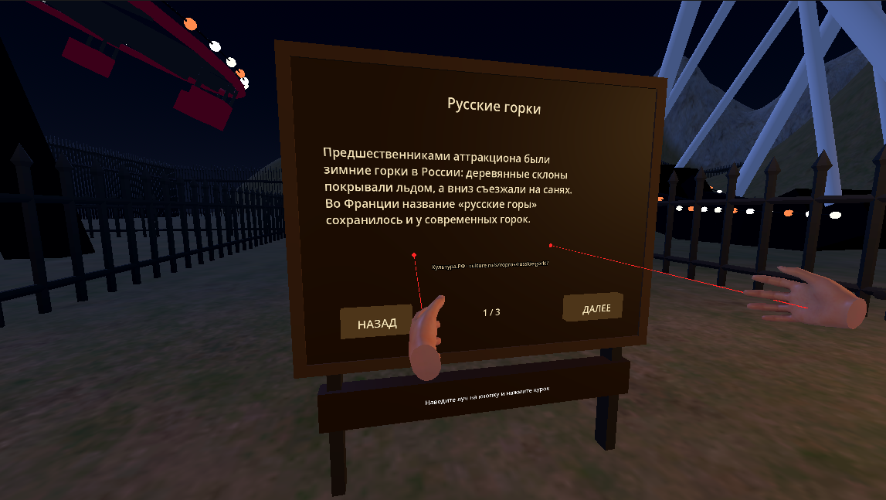
  <br>
  <em>Информационный стенд </em>
</p>

<p align="center">
  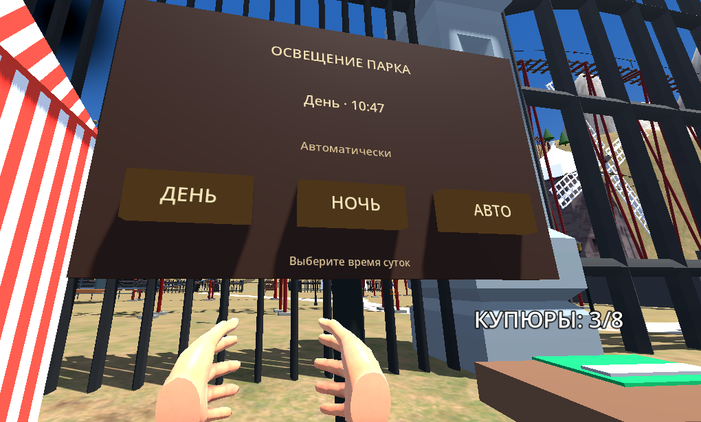
  <br>
  <em>Выбор времени</em>
</p>

<p align="center">
  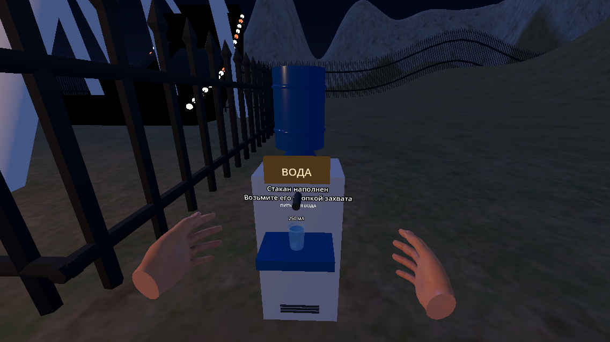
  <br>
  <em>Кулер с водой</em>
</p>

## Источники и материалы

- [Официальный сайт Godot Engine](https://godotengine.org/).
- [Документация Godot Engine](https://docs.godotengine.org/).
- [Godot XR Tools](https://github.com/GodotVR/godot-xr-tools).
- [История русских горок — Культура.РФ](https://www.culture.ru/s/vopros/russkie-gorki/).
- [История появления американских горок — Ridus](https://www.ridus.ru/amerikanskie-gorki--kak-poyavilsya-samyj-izvestnyj-v-mire-attrakcion-357349.html).
- [Roller coaster — Wikipedia](https://en.wikipedia.org/wiki/Roller_coaster).
